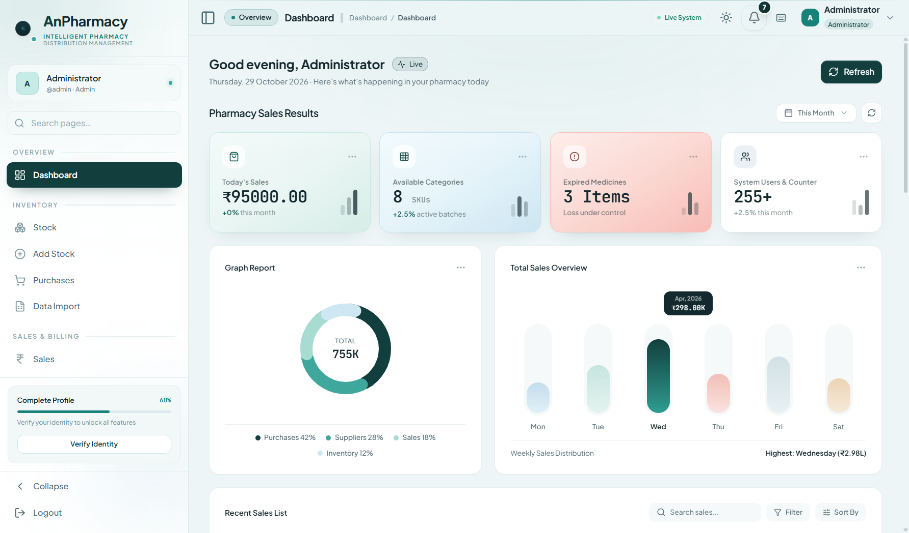
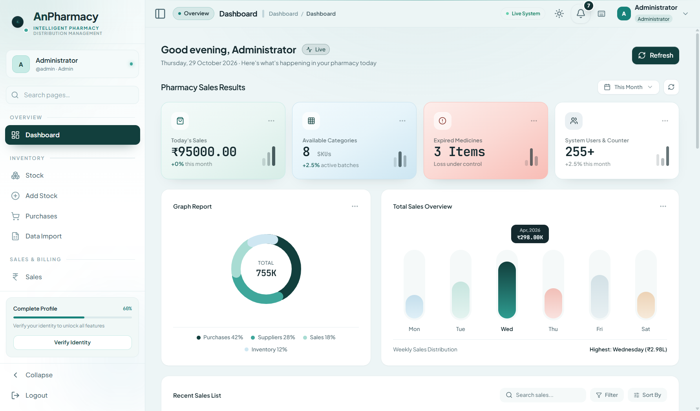
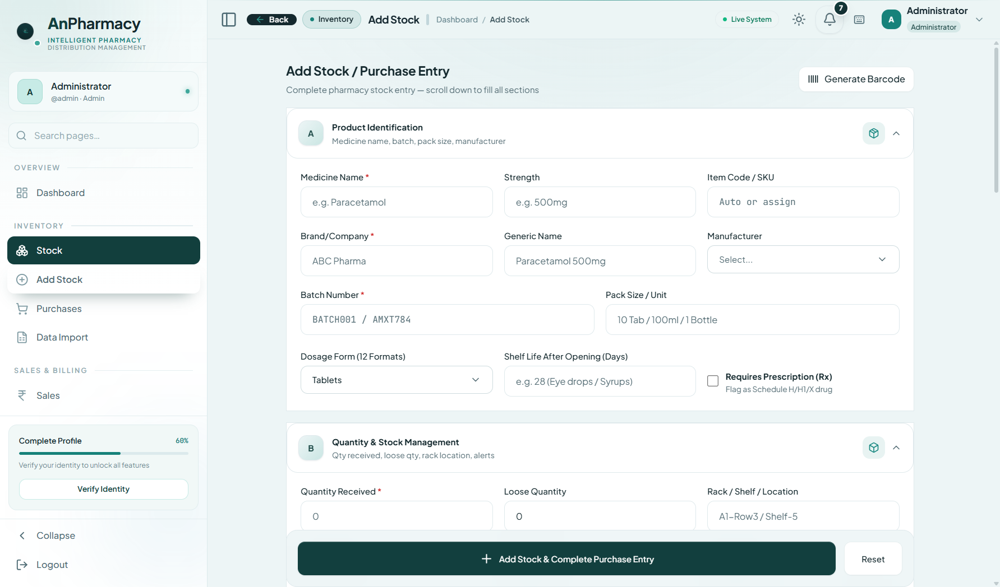
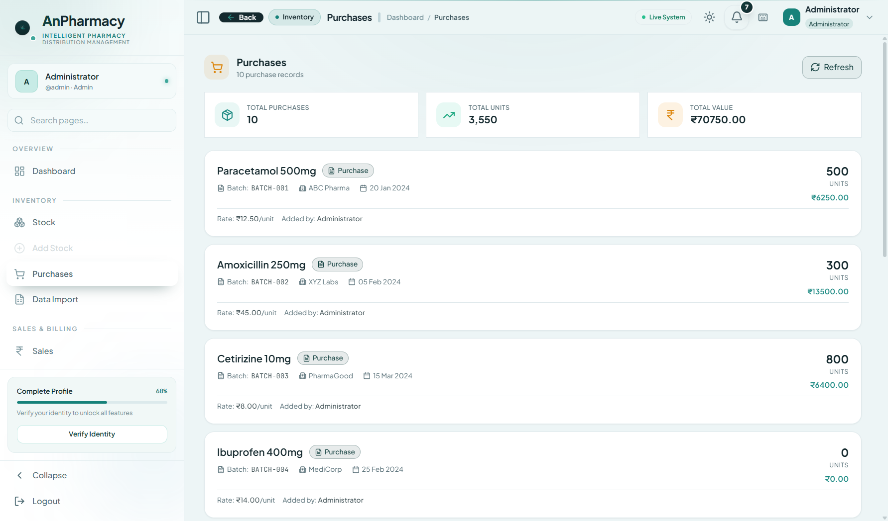
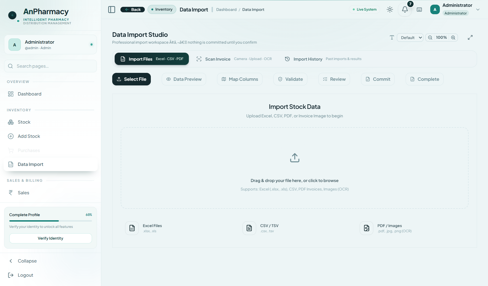
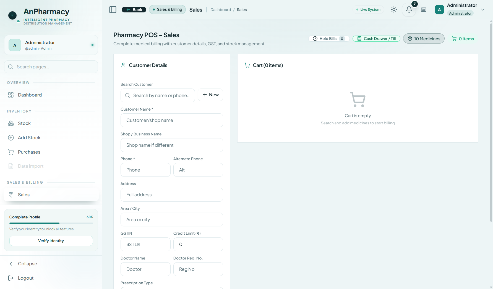
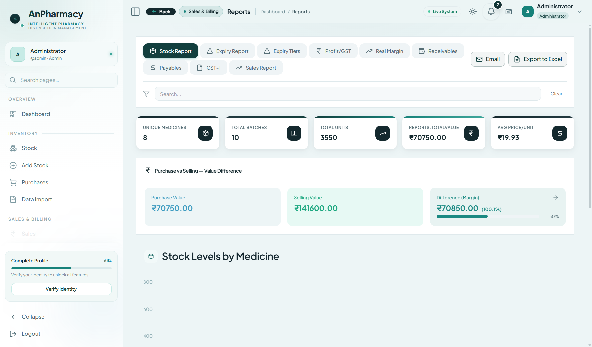
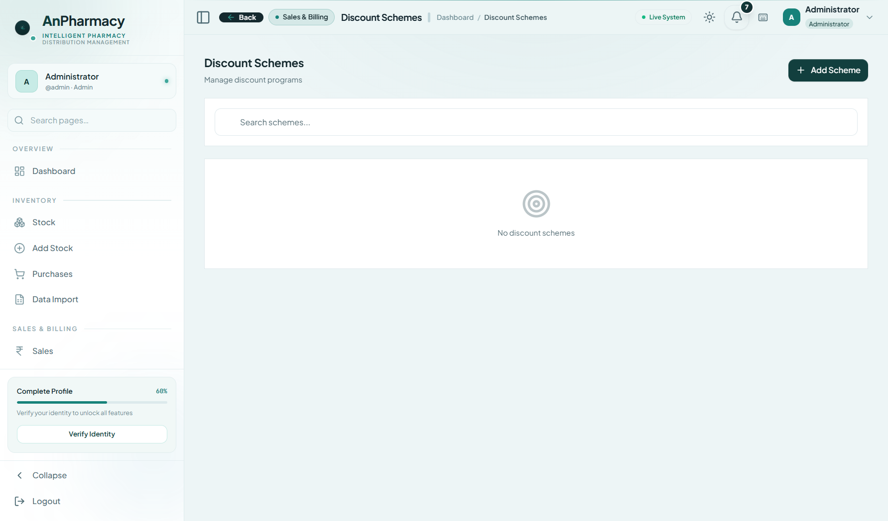
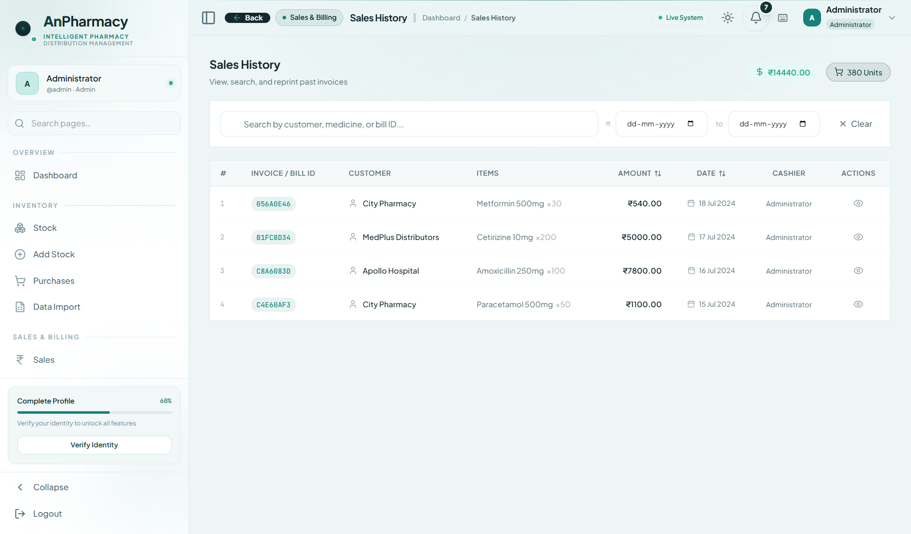

<div align="center">

# AnPharmacy
### Enterprise Medicine Distribution & Intelligent Pharmacy Management System

<br/>

[](LICENSE)
[](https://github.com/anas116-ai/AnPharmacy)
[](https://github.com/anas116-ai/AnPharmacy)
[](https://github.com/anas116-ai/AnPharmacy)
[](LICENSE)

<br/>

<p align="center">
  <strong>An enterprise-grade, offline-first pharmacy distribution and management system.</strong><br>
  Built with Electron 43, React 19, TypeScript, Tailwind CSS, and embedded SQLite with zero external cloud dependencies.
</p>

[Key Features](#-key-features) • [Application Visual Tour](#-application-visual-tour) • [Technology Stack](#-technology-stack) • [Getting Started](#-getting-started) • [Default Credentials](#-default-credentials) • [License & Commercial Deployment](#-license--commercial-deployment)

</div>

---

## ⚡ Key Features

| Core Capability | Enterprise Impact & Technical Specification |
| :--- | :--- |
| **100% Offline SQLite Engine** | Operates air-gapped with zero cloud dependencies or network downtime. Sub-millisecond database queries via `better-sqlite3`. |
| **FEFO Batch Allocation** | Strict *First-Expired, First-Out* algorithm prioritizes nearest-expiring medicine batches during billing to prevent costly expired write-offs. |
| **Optical OCR Inward Invoicing** | Integrated Otsu binarization and Tesseract OCR engine scans printed supplier invoices and auto-populates batch numbers, MRP, PTR, and taxes. |
| **Data Import Studio** | Intelligent auto-mapping for wholesale distributor spreadsheets (`.xlsx`, `.xls`, `.csv`) with schema verification and profile caching. |
| **Multi-Tier GST Billing & POS** | Instant calculation of CGST, SGST, IGST, HSN tax categorization, and split batch billing with thermal/A4 tax invoice generation. |
| **Hardware-Locked Security** | Cryptographic machine identification (HWID) license binding, SHA-256 password hashing, and local AES-256 encrypted database backups. |
| **Regulatory & Schedule Compliance** | Integrated tracking for Schedule H, H1, X narcotics, and critical antibiotics requiring valid doctor prescriptions and license audits. |

---

## 📸 Application Visual Tour

The application is engineered with an executive medical design language — clean, light, high-contrast, and distraction-free for pharmacy counters and distribution warehouses.

---

### 1. Landing Page
Clean, clinical overview explaining system capabilities, 100% offline architecture, and feature modules.


---

### 2. Login Page
Secure role-based authentication portal supporting Administrator, Sales Executive, and Purchase Manager sessions with hardware-bound authorization.


---

### 3. Executive Dashboard
Real-time KPI telemetry, daily sales velocity, cash vs. credit breakdowns, stock valuation, and proactive FEFO expiration radar.


---

### 4. Stock & Inventory Management
Centralized inventory ledger with real-time stock balances, batch-level tracking, rack locations, and reorder point triggers.


---

### 5. Add Stock / Inward Medicine Form
Comprehensive batch entry interface capturing brand names, generic compositions, manufacturer details, batch numbers, MRP, PTR, PTS, tax rates, and expiry dates.


---

### 6. Purchases & Supplier Procurement
Inward shipment ledger for logging wholesale bills, verifying line-item costs, validating drug license details, and auto-updating warehouse inventory.


---

### 7. Data Import Studio
Smart distributor spreadsheet ingestion — upload Excel or CSV wholesale lists with intelligent column detection, live preview, and batch-wise import.


---

### 8. Sales (Billing / POS)
High-speed counter billing terminal with automated FEFO batch allocation, barcode scanning, doctor prescription attachment, and instant GST invoice generation.


---

### 9. Reports & Distribution Analytics
In-depth financial intelligence covering gross margins, profit velocity, sales trends, supplier balances, and GST filing summaries.


---

### 10. Discounts & Pricing Schemes
Configure volume schemes, festival discounts, cash payment rebates, and manufacturer promotional margins with automatic checkout deduction.


---

### 11. Sales History & Ledger
Complete audit trail of all completed sales, customer invoices, payment modes (Cash, UPI, Credit Card), and print re-issuance.


---

### 12. Scan Invoice OCR Intake *(Supplementary)*
Optical character recognition interface that scans printed paper invoices and extracts medicine names, batch codes, quantities, and GST rates.


---

### 13. Suppliers & Manufacturer Directory *(Supplementary)*
Directory of verified pharmaceutical distributors, drug license certificates, GSTIN records, payment terms, and contact representatives.


---

## 🛠️ Technology Stack

* **Desktop Runtime:** [Electron 43.1](https://www.electronjs.org/) (Chromium + Node.js)
* **Frontend Framework:** [React 19.2](https://react.dev/) with [TypeScript 7.0](https://www.typescriptlang.org/)
* **Build System:** [Vite 8.1](https://vitejs.dev/) with fast HMR
* **Styling & Design System:** [Tailwind CSS 3.4](https://tailwindcss.com/) + Custom Design Tokens (Medical Teal, Mint & Clean Light Slate)
* **Embedded Database:** [better-sqlite3 12.1](https://github.com/WiseLibs/better-sqlite3) (Zero-cloud latency)
* **State Management:** [Zustand 5.0](https://github.com/pmndrs/zustand)
* **Data Visualization:** [Recharts 2.15](https://recharts.org/) & Chart.js
* **OCR & Vision Engine:** [Tesseract.js](https://tesseract.projectnaptha.com/) + Custom Otsu Image Binarization
* **Spreadsheet Processing:** [SheetJS (xlsx)](https://sheetjs.com/)

---

## 🚀 Getting Started

### Prerequisites
* **Node.js:** v18.0.0 or higher
* **npm:** v9.0.0 or higher
* **Operating System:** Windows 10/11, macOS 12+, or Ubuntu 20.04+

### Installation & Launch

```bash
# Clone repository
git clone https://github.com/anas116-ai/AnPharmacy.git
cd AnPharmacy

# Install dependencies
npm install

# Start development server and Electron runtime
npm run dev
```

### Production Build

```bash
# Compile React application and verify types
npm run build

# Package desktop installer for your target OS
npm run electron:build
```

---

## 🔐 Default Credentials

The initial database seed includes default role profiles for system evaluation:

| Role | Username | Default Password | Granted Permissions |
| :--- | :--- | :--- | :--- |
| **Administrator** | `admin` | `admin@123` | Full administrative control, system settings, database backup/restore, license management |
| **Sales Executive** | `sales` | `sales@123` | High-speed POS counter billing, customer ledger, stock query, sales history |
| **Purchase Manager** | `purchase` | `purchase@123` | Procurement, distributor invoice scanning, bulk Excel data import, supplier directory |

> [!TIP]
> In production installations, change all default passwords immediately via **User Management** (`#users`).

---

## ⌨️ Desktop Keyboard Shortcuts

| Shortcut | Destination / Action |
| :--- | :--- |
| `Ctrl + D` | Jump to **Dashboard** |
| `Ctrl + S` | Jump to **Stock / Inventory** |
| `Ctrl + N` | Jump to **Add Stock Form** |
| `Ctrl + P` | Jump to **Purchases Management** |
| `Ctrl + B` | Jump to **Sales (POS Billing)** |
| `Ctrl + R` | Jump to **Reports & Analytics** |
| `Ctrl + M` | Toggle Sidebar Collapse / Expand |
| `Ctrl + Shift + S` | Quick Save Inward Bill / Form |
| `F1` | Open Keyboard Shortcuts Cheatsheet |

---

## 📄 License & Commercial Deployment

**Copyright (c) 2024–2026 AnPharmacy Solutions. All Rights Reserved.**

This software is licensed under the **AnPharmacy Enterprise Commercial License**.
- **Evaluation & Non-Production Testing:** Permitted for audit, educational, and evaluation purposes.
- **Commercial Production Deployment:** Requires an authorized enterprise hardware-bound license key (HWID).

See the [LICENSE](LICENSE) file for complete legal terms, or contact `licensing@anpharmacy.com` for multi-store and wholesale distribution deployments.
