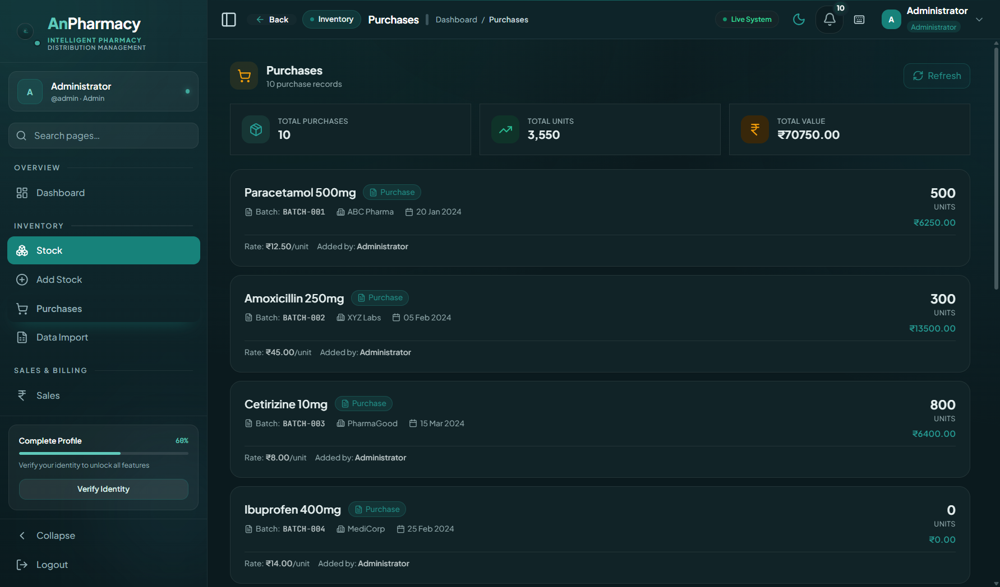
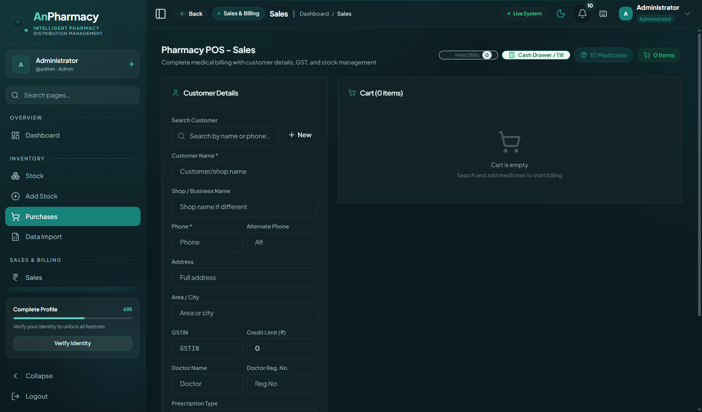
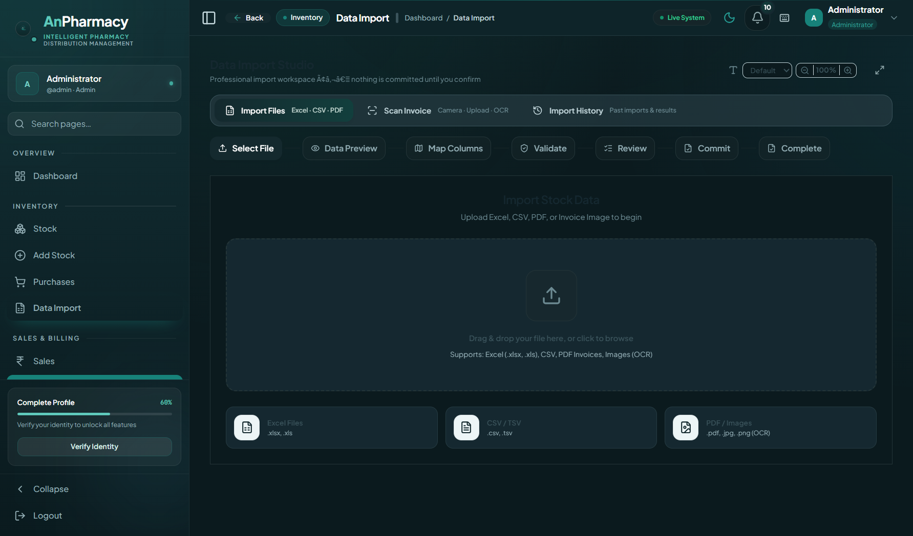
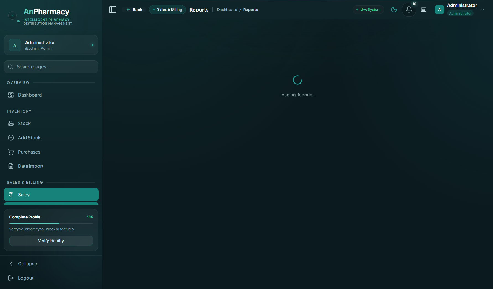
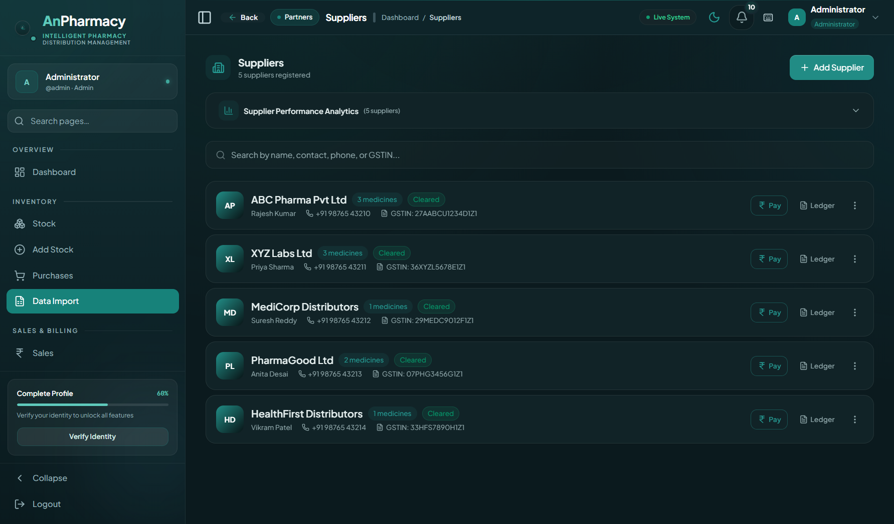

<div align="center">

# 🏥 AnPharmacy
### Medical Distribution & Pharmacy ERP System

[](https://github.com/anas116-ai/AnPharmacy)
[](LICENSE.txt)
[](https://github.com/anas116-ai/AnPharmacy)
[](https://github.com/anas116-ai/AnPharmacy)

<p align="center">
  <strong>An enterprise-grade, local-first pharmacy distribution and management system.</strong><br>
  Built with Electron 43, React 19, TypeScript, Tailwind CSS, and embedded SQLite with zero external cloud dependencies.
</p>

[Key Features](#-key-features) • [Screenshots](#-screenshots--ui-showcase) • [Architecture](#-architecture) • [Getting Started](#-getting-started) • [Keyboard Shortcuts](#-keyboard-shortcuts)

</div>

---

## 📸 Screenshots & UI Showcase

### 1. Executive Command Center & Dashboard
Real-time KPI telemetry, daily revenue velocity, cash vs. credit breakdowns, smart reorder triggers, and FEFO expiry radar.


### 2. Clinical Landing Page & Brand Experience
Clean obsidian & clinical emerald design system without AI template slop or distracting marketing noise.


### 3. Secure Role-Based Authentication
Air-gapped authentication with hardware-bound license verification and role-specific workspace configurations.


### 4. Inventory Management & FEFO Batch Engine
Strict First-Expiry-First-Out (FEFO) batch tracking, batch-level MRP/PTR/PTS margins, and barcode search.


### 5. Procurement & Purchases
Comprehensive supplier bill entry, batch verification, tax-breakup computation, and automatic stock updates.


### 6. High-Speed Point of Sale (POS) Billing
Counter checkout optimized for speed with automated batch allocation, GST invoices, and thermal receipt printing.


### 7. Data Import Studio (Smart Distributor Mapper)
Drop in any distributor Excel or CSV spreadsheet — auto-detects and maps columns with instant sample preview.


### 8. Analytics, Reports & GST Intelligence
Granular sales velocity, profit margins, supplier purchase summaries, and export-ready GST compliance data.


### 9. Supplier & Manufacturer Directory
Centralized repository of pharmaceutical manufacturers, distributors, credit terms, and contact profiles.


---

## ⚡ Key Features

| Capability | Technical Details |
| :--- | :--- |
| **Local-First & Air-Gapped** | Runs 100% offline with zero cloud latency. Embedded SQLite database (`better-sqlite3`). |
| **FEFO Allocation Engine** | Automatically allocates the nearest expiring batch during billing to prevent dead-stock write-offs. |
| **OCR Purchase Invoice Scanner** | Built-in Otsu image binarization & Tesseract OCR for automated bill data extraction. |
| **Data Import Studio** | Smart column mapper with profile persistence for Excel (`.xlsx`, `.xls`) and CSV distributor files. |
| **Enterprise Security** | Hardware-bound license activation, SHA-256 passwords, and AES-256 encrypted local backups. |
| **Executive Keyboard Shortcuts** | Full desktop keyboard navigation (`Ctrl+D`, `Ctrl+S`, `Ctrl+N`, `Ctrl+P`, `Ctrl+M`, `Ctrl+R`). |
| **GST & Regulatory Ready** | HSN code validation, Schedule H/H1/X compliance tracking, CGST/SGST/IGST tax breakdowns. |

---

## 🛠️ Technology Stack

* **Desktop Runtime:** [Electron 43.1](https://www.electronjs.org/)
* **Frontend Framework:** [React 19.2](https://react.dev/) + [TypeScript 7.0](https://www.typescriptlang.org/)
* **Build System:** [Vite 8.1](https://vitejs.dev/)
* **Styling & Design System:** [Tailwind CSS 3.4](https://tailwindcss.com/) + Custom Design Tokens (Medical Emerald & Slate)
* **Local Database:** [better-sqlite3 12.1](https://github.com/WiseLibs/better-sqlite3)
* **State Management:** [Zustand 5.0](https://github.com/pmndrs/zustand)
* **Data Visualization:** [Recharts 2.15](https://recharts.org/) & Chart.js
* **OCR & Document Engine:** [Tesseract.js](https://tesseract.projectnaptha.com/) + [PDF.js](https://mozilla.github.io/pdf.js/)
* **Spreadsheet Engine:** [SheetJS (xlsx)](https://sheetjs.com/)

---

## 🚀 Getting Started

### Prerequisites
* [Node.js](https://nodejs.org/) v18.0.0 or higher
* npm v9.0.0 or higher

### Installation

1. **Clone the repository:**
   ```bash
   git clone https://github.com/anas116-ai/AnPharmacy.git
   cd AnPharmacy
   ```

2. **Install project dependencies:**
   ```bash
   npm install
   ```

3. **Start development mode:**
   ```bash
   npm run dev
   ```
   * Vite dev server launches at `http://localhost:5174/`
   * Electron desktop application boots automatically with local SQLite database.

---

## 🔑 Default Roles & Access

| Role | Username | Default Password | Access Scope |
| :--- | :--- | :--- | :--- |
| **Administrator** | `admin` | `admin@123` | Full system control, user management, backup/restore, license config |
| **Sales Representative** | `sales` | `sales@123` | Dashboard, Stock viewing, Point of Sale, Sales history |
| **Purchase Manager** | `purchase` | `purchase@123` | Dashboard, Stock entry, Purchase invoices, Data import studio |

---

## ⌨️ Keyboard Shortcuts

| Shortcut | Action |
| :--- | :--- |
| <kbd>Ctrl</kbd> + <kbd>D</kbd> | Navigate to Executive Dashboard |
| <kbd>Ctrl</kbd> + <kbd>S</kbd> | Open Stock & Inventory Management |
| <kbd>Ctrl</kbd> + <kbd>N</kbd> | Quick Add New Medicine Batch |
| <kbd>Ctrl</kbd> + <kbd>P</kbd> | Navigate to Purchases |
| <kbd>Ctrl</kbd> + <kbd>M</kbd> | Open Point of Sale (POS) Billing |
| <kbd>Ctrl</kbd> + <kbd>R</kbd> | Open Analytics & Reports |
| <kbd>Ctrl</kbd> + <kbd>F</kbd> | Global Search focus |
| <kbd>Esc</kbd> | Close active Modal or Drawer |
| <kbd>Ctrl</kbd> + <kbd>Shift</kbd> + <kbd>/</kbd> | Open Keyboard Shortcuts Cheat Sheet |

---

## 📦 Production Packaging

To compile standalone desktop executables for distribution:

```bash
# Windows x64 (.exe installer + portable)
npm run dist:win

# macOS (.dmg)
npm run dist:mac

# Linux (.AppImage / .deb)
npm run dist:linux
```

Output installers are generated inside the `release/` directory.

---

## 📄 License

This project is licensed under the **ISC License**. See the [LICENSE.txt](LICENSE.txt) file for details.

---

<div align="center">
  <sub>Developed with ❤️ for modern pharmaceutical distributors & retail pharmacies.</sub>
</div>
